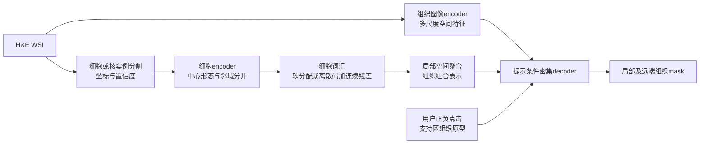

# CVPR：细胞词汇与双分支编码器探索大纲

日期：2026-10-30。状态：文献检索与总体设计完成；模型、码本和新实验均为 planned。用户已决定放弃当前AAAI rebuttal路线，转向CVPR新论文，允许探索新encoder和细胞分支。本条取代此前“先完成旧15WSI再允许新方法”的工作优先级；既有实验、失败结果和原权重继续保留。没有执行投稿平台撤稿、停止后台任务、下载权重或新训练。

## 1. 核心判断与拟研究问题

“相似细胞拉近、不同细胞拉远”属于细胞表征/度量学习，已有直接文献；“再映射到有限词表中的一个编号”才进一步涉及离散tokenizer/向量量化。前者不会自动产生一个稳定的离散词汇表，也不会自动知道什么是生物学上的相似。

推荐的问题表述：**能否把H&E中的细胞形态编码为跨空间区域可复用的词汇，并利用这些词汇的空间组合，让少量用户点击定义一种组织模式、在WSI远处检出该模式？**

核心假设：视觉细胞表征提供局部身份/状态证据；细胞空间组合提供组织微环境证据；密集图像分支补足细胞稀疏区域和边界。码本是否比连续特征更好，必须作为可证伪问题，不能预设。既有XCell在当前局部分割的稳定增益很小，证明“更好的细胞分支带来下游价值”是必要实验。

## 2. 直接相关的一手文献与差异

| 工作 | 核验的机制 | 对我们的意义与边界 |
|---|---|---|
| [Nuc2Vec，MIDL2021](https://proceedings.mlr.press/v143/feng21a.html) | 核分割后用对比学习得到形态embedding并形成有意义的亚型分组 | 与用户第一步最直接相关；不能宣称首个细胞对比表征 |
| [VOLTA，Nature Communications2024](https://www.nature.com/articles/s41467-024-48062-1)，[公开全文](https://pmc.ncbi.nlm.nih.gov/articles/PMC11087497/) | 将细胞与其环境关系纳入自监督对比学习 | 单细胞加上下文已有先例；它不等于我们的点击条件WSI分割 |
| [LEMON，2026预印本](https://arxiv.org/abs/2603.25802)，[官方权重卡](https://huggingface.co/aliceblondel/LEMON) | 面向单细胞/细胞核图像的自监督形态encoder | 优先加入新cell encoder候选，不把tile分类模型默认当最佳细胞模型 |
| [PathVQ，2025](https://arxiv.org/abs/2503.06482) | 对病理空间patch特征做VQ蒸馏、压缩和多尺度学习 | 病理token量化不是空白；其token单位是图像patch，不是实例细胞 |
| [SQUINT，2026-08预印本](https://www.biorxiv.org/content/10.64898/2026.08.07.743490v1?rss=1) | 空间转录组上分别量化细胞自身embedding和GNN聚合后邻域embedding，采用残差VQ | 与“细胞词汇+微环境词汇”非常接近；输入为分子表达，不能冒称H&E模型，但双码本本身不能作为我们的首创 |
| [CellViT++](https://arxiv.org/abs/2501.05269)，[官方实现](https://github.com/TIO-IKIM/CellViT-plus-plus) | 结合预训练模型进行核实例分割、细胞表征与分类适配 | 可用于实例/特征联合提取的效率对照；首次表征实验固定同一分割结果，避免混入检测器收益 |

基础方法：[VQ-VAE](https://arxiv.org/abs/1711.00937)用于连续特征的离散编码；[SwAV](https://arxiv.org/abs/2006.09882)以跨增强的聚类分配一致性学习表征。可借鉴，均不构成病理新颖性证据。

检索时间为2026-10-30，来源包括论文主页/全文和作者模型卡。SQUINT本次核验到bioRxiv的检索全文摘要，其直接打开受到403限制；不据早期匿名OpenReview页面声称最终会议录用。以上是针对当前构想的重点检索，不是穷尽检索或首创认证。

## 3. 推荐架构：图像连续细节 + 细胞可复用词汇

### A. 组织图像encoder

第一轮比较现有COCO/ResNet基线、一种可获取的病理预训练空间encoder，以及SAM预训练交互路径。病理候选以[UNI2-h](https://huggingface.co/MahmoodLab/UNI2-h)或[Phikon-v2](https://huggingface.co/owkin/phikon-v2)为起点，具体由可用权重、真实空间token质量和吞吐决定，不按参数量选冠军。使用空间token/多层特征，不能用全图CLS插值冒充密集信息。

两类实验分清：固定同一个新decoder比较backbone，可隔离特征来源；保留SAM原生预训练decoder是完整系统基线，两者不宣称只差encoder。先冻结特征的小试验，再考虑少量层/LoRA联合适配；不先从头训练大型基础模型。

### B. 细胞实例与cell encoder

全图细胞实例预处理只做一次，记录全局cell ID、坐标、核/细胞mask、物理尺度、检测置信度；跨tile重复实例去重，边缘实例规则固定。核分割并不等于完整细胞边界，全文需按实际输入称谓。

初选现有CTransPath/XCell、LEMON，以及病理空间特征的中心区域/mask pooling；从同一批细胞、同一标签来源、同一物理区域比较，额外上下文单独记账。LEMON官方输入是40×40像素、0.25µm/px，不能把旧任意128/224像素crop直接作为等价输入。对tile模型，优先比较中心空间token与整tile CLS，避免邻居遮盖目标细胞。

本地已有负证据：0907五cohort冻结Phikon双视野试验paired macro-F1为0.1247、shuffle为0.1264；单section LoRA+RNA没有超过label-only。它们不否定新encoder，但意味着不能把“换Phikon或加RNA”当未试过且已知有效。新实验需先检查尺度、实例对应、label ontology和中心特征读取。

### C. 从embedding到细胞词汇

连续特征 `z_i = E_cell(crop_i, mask_i)` 可直接作为一个Transformer token；如果需要离散词汇，再学习训练集全局共享的codebook `C={c_1,...,c_K}`，例如 `k_i=argmin_k ||z_i-c_k||²`。全局共享指仅训练区拟合，部署切片查表；不是每张WSI重新聚类产生无法对齐的ID。

首轮三个清楚的版本：连续embedding；冻结embedding的k-means词表；带表征学习的软/可学习码本。K=64/128/256可作为小范围预先登记的压缩敏感性，首个pilot固定一个值，不能在主测试集挑最佳K。保留 `z_i-c_{k_i}` 或低维连续旁路，避免将形态状态硬压成一个编号；软分配更适合模糊/过渡细胞。词ID只表示学习到的形态模式，不自动等于“淋巴细胞/癌细胞”或已知生物类型，K也不等于12组织类数。

**关键是如何定义相似：**

- 同一实例的两种合理增强是可靠正对，保持目标核可见，不用裁掉目标的增强。
- 有可靠细胞类型/marker注释时，使用多正例的监督或层级对比目标；保留同类型内部的形态状态差异。不能把不同cell ID一律作为应远离的不同生物类型。
- 无标签细胞采用教师分配一致性/聚类一致性，邻居伪正例需置信度和跨块检验，不能以模型自己相似就当生物真值。
- 相邻细胞不一定同类；位置属于组织结构，不应主导细胞身份code。细胞自身与邻域组合分开建模。
- 若使用内部mIF/RNA，只对已核验单细胞对应、marker可支持的层级提供训练监督；缺失marker不是阴性。连续切片或spot级信号不当逐细胞真值。加入正确配对/打乱配对/无组学控制，部署仅H&E。H&E不能辨认的分子状态保留不确定性，不强迫分成视觉可预测类别。

优化先从表征一致性/可靠对比目标开始，再加量化保真和温和防塌缩项；不首轮叠满所有loss。检查有效码数、频率、量化误差、稀有细胞覆盖和染色/扫描来源可预测性。防塌缩不等于让所有生物类型频率均匀。

### D. 细胞词汇怎样帮助组织分割

单个细胞code不能决定组织：相似细胞在不同空间排列中可能属于不同结构。局部kNN/稀疏attention聚合cell code、形态残差、相对几何、密度和置信度，得到组织组合表示；首轮先用连续邻域表示，只有单细胞码本已有效才试第二级niche码本，避免立即重做SQUINT式双码本。

用户点击读取图像特征与周围的细胞组合，形成有符号、多原型的支持描述；query图像像素与这些描述匹配，再由dense decoder输出完整组织mask。不是只把核涂成正类，也不是只查同code细胞。脂肪、胶原、腔隙、黏液、坏死等细胞稀疏结构依靠图像支路，cell分支按置信度门控，缺少细胞不等于背景。

全WSI不直接对百万细胞做全连接attention。采用实例分割/特征离线缓存、局部空间聚合、区域级索引与分窗像素解码，测量准备时间、存储、缓存后点击延迟和峰值显存。未审计覆盖的分窗结果不能声称100%整片分割。

## 4. CVPR贡献应落在哪

候选贡献是“面向用户指定组织的形态词汇与空间组合匹配”：将细胞级表征、跨区域提示迁移和像素组织输出建立可解释的联系，而不是换encoder后加VQ模块。明确与Nuc2Vec/VOLTA的连续细胞表征、PathVQ的patch压缩、SQUINT的分子双词表区别。

需要三条证据：词汇跨染色/空间区域仍稳定且保留稀有形态；相同组织视觉底座下词汇优于连续细胞特征或取得明确质量—存储折中；这些收益真实转化为同点击预算的组织质量、远端误报或交互效率。仅UMAP好看、细胞分类提高、容量变大都不足以支撑组织分割贡献。

若离散化损害质量且无有用效率收益，应保留连续细胞token方案，不能为了tokenizer叙事强制使用VQ。若换encoder后image-only已获得全部增益，需如实下调细胞词汇的贡献定位。

## 5. 最小研究顺序

| 阶段 | 内容 | 通过证据 |
|---|---|---|
| P0 数据/旧证据审计 | 固定细胞实例、物理crop、对应label与空间split，检查既有模型/缓存暴露 | 真实实例可视核验、输入footprint隔离、来源/权重SHA |
| P1 两条encoder筛选 | image-only密集分割与cell-only检索/线性probe分别做；先少量候选 | 同协议质量、跨块检索、按类结果和提取成本；不先全图重算所有候选 |
| P2 词汇价值 | 同cell encoder：连续、k-means、可学习词汇；固定图像主干 | 词汇稳定性、稀有类、量化保真及下游净收益 |
| P3 空间/提示价值 | 词频汇总vs带位置邻域；相同支持点击条件，训练local及remote/absent episode | 组织质量、远端误报和点击曲线；局部与迁移分表 |
| P4 扩大与确认 | 有效候选扩WSI、多seed、独立外部/未用于调参的空间块 | 配对不确定性、所有类别结果、缓存和在线成本 |

建议固定同一个最优候选图像encoder后做：image-only、+原XCell、+新连续细胞、+固定聚类词汇、+可学习词汇、+空间组合。进一步做数量/位置保留而形态打乱的控制，以及相同容量未量化adapter控制，区分“更多参数/更多细胞信息”和真正的词汇收益。历史无细胞推理置零只是敏感性分析，不能替代重新训练的image-only对照。

编码器/码本/归一化/聚类都只在训练区拟合；保留空间块划分，完整细胞crop、邻域图和低倍上下文不可跨split漏入。来源/患者标识保留，不强加patient-disjoint。原开发集已多轮诊断，正式新方法需独立确认。现有15WSI成果可按新研究需要复用，但不再为了旧rebuttal完成所有遗留项目。

## 6. 当前边界与下一步

本次是总体大纲与可追溯文献研究，没有新质量结果。当前最有区分度的下一步是核验小批细胞crop并比较**原XCell、细胞专用LEMON、病理encoder中心空间特征**，同时建立一个更强image-only基线；再决定是否值得学习词表，避免先投入整片全部细胞的重编码。

数据资源依据本地`docs/数据集情况/【7】基因-病理-疾病相关数据.csv`与既有配准/监督记录；本轮没有重新接受这些队列的全量可用性。旧实验记录与原始数值保留；新架构在benchmarks/v5实现，aligner环境，产物独立时间戳目录。论文题目、模型名称、最终编码器、CVPR届次/日程均未在本轮冻结。
