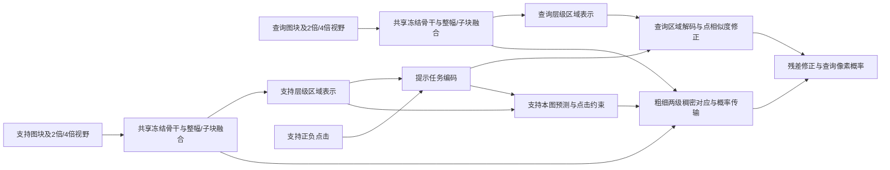

# FewClick：面向用户指定病理组织的少点击交互分割框架

> 中文审阅稿｜2026-11-14。方法版本：HG-mix。空白单元格及“________”为待补内容；实验依据见[证据索引](中文初稿_证据索引_1114.json)。

## 摘要

全切片病理图像中的组织分割为组织量化和肿瘤微环境分析提供基础。固定类别模型难以适应使用者临时指定的组织目标，而在多个不连通区域逐次给出提示又增加了交互负担。本文提出FewClick，一种由少量正负点击定义目标组织的同片迁移分割框架。用户在一个支持图块中提供提示，模型据此分割同一切片其他图块中的目标组织。FewClick融合整幅与局部子块特征，通过可学习的层级区域表示组织上下文，并结合正负支持证据生成初始分割；粗细两级稠密对应将支持预测概率传输至查询区域，进一步修正像素输出。在相同新增训练任务和更新预算下，使用三个正支持点和两个负支持点，FewClick在11,000个同片远端开发任务上取得42.11%的目标存在类别宏Dice和78.49%的大目标类别宏Dice，分别高于SANSA约0.57和1.27个百分点，目标缺失误报面积比例由14.79%降至7.75%。在15张全切片、152个组织任务上，整片和严格远端类别宏Dice分别为43.75%和40.98%，较SANSA提高10.52和10.86个百分点。匹配重训消融中，移除稠密迁移或区域跨尺度消息分别使大目标Dice降低3.13和0.83个百分点。

## 1 引言

全切片病理图像以大范围、高分辨率的形式记录组织形态，支持肿瘤区域量化、组织组成分析和感兴趣区域筛选。组织边界复杂、结构尺度变化大，使密集像素标注具有较高成本。与此同时，实际分析目标随研究问题而变化：同一张切片可能需要分别提取肿瘤上皮、间质或脂肪等组织。按固定类别输出的分割方式难以直接表达这种由使用者指定的目标。

稀疏交互提示提供了一种直接的目标定义方式，但将其用于全切片组织分割仍面临三个问题。首先，同类组织可能分布在多个不连通区域，局部提示需要传递超出其邻域的组织信息。其次，不同组织可能具有相似的局部纹理，目标识别还依赖周围结构及排除示例。第三，组织判断需要较完整的语境，而边界和小区域分割需要保留局部细节。图像范围扩大后，这些问题还伴随着逐区域交互和重复计算的成本。

因此，少点击全切片分割需要从局部正负示例中识别使用者指定的组织，并在同片远端区域中恢复相应目标。我们的出发点是，区域上下文与空间对应提供了两种互补的信息：前者组织不同尺度的组织结构，后者保留支持示例与查询位置之间的细粒度联系。这促使我们将层级区域预测与稠密概率传输结合，并通过整幅与子块表征保留不同粒度的视觉信息。

FewClick的整体流程如图1所示。共享图像骨干提取精细、中间和粗尺度视野的特征；精细视野进一步融合整幅与四个子块的表征。软分配将空间特征聚合为可学习区域，跨尺度路径传递组织上下文。正负支持提示形成任务条件，区域解码与点击相似度生成初始概率。粗细两级对应随后将模型预测的支持概率传输至查询区域，形成最终像素修正。每次交互只需在一个支持图块给点，其他查询区域无需追加人工提示。

本文的贡献包括三个方面。（1）提出结合层级区域上下文、正负支持证据和粗细两级稠密概率传输的组织迁移框架，将单个支持图块的少量点击用于同片远端分割。（2）设计整幅与子块特征的等权融合方式，并与更大物理视野的区域表示结合，同时利用完整语境与局部细节。（3）在统一支持提示和新增适配预算下，完成11,000个远端任务与15张全切片的六方法比较，并通过表征与结构消融分析各模块的作用。FewClick在远端开发队列上取得42.11%的目标存在类别宏Dice和7.75%的目标缺失FPA，在整片评价上取得43.75%的类别宏Dice。

## 2 相关工作

### 2.1 病理组织分割与多尺度表示

病理组织识别依赖局部形态与较大范围结构。HookNet通过多个分辨率下的同心图块和分支间特征连接组合语境与细节，用于病理组织的语义分割[1](https://doi.org/10.1016/j.media.2020.101890)。Phikon-v2使用DINOv2自监督学习获得病理图像表征，并公开用于下游特征提取[2](https://arxiv.org/abs/2409.09173)。这些工作为组织上下文建模和视觉表征提供基础。本文使用冻结的Phikon-v2骨干，将整幅与子块表征组织为提示条件化的区域及对应关系，研究支持示例如何在同一张切片的远端区域中使用。

### 2.2 提示分割与参考信息传播

SAM通过点、框等提示定义分割目标[3](https://openaccess.thecvf.com/content/ICCV2023/html/Kirillov_Segment_Anything_ICCV_2023_paper.html)，SAM2进一步以提示和传播机制处理图像与视频[4](https://arxiv.org/abs/2408.00714)。面向医学数据，SAM-Med2D使用医学图像与掩膜适配SAM[5](https://arxiv.org/abs/2308.16184)；WSI-SAM面向病理图像，以多分辨率结构整合不同视野的信息[6](https://proceedings.mlr.press/v254/liu24a.html)。SANSA则通过对SAM2表征的适配服务于少样本分割，并支持点、框和涂画等提示[7](https://proceedings.neurips.cc/paper_files/paper/2025/hash/ac6ab84809cef04dbe11e9b80d63c281-Abstract-Conference.html)。

这些方法提供了不同的目标条件化接口。本文关注单个支持图块到同片远端图块的组织迁移：SAM系列通过支持—查询迁移桥产生查询预测，SANSA通过支持帧到查询帧传播参考信息。比较统一使用支持图块中的少量点击；各方法的公共预训练、输入视野与适配模块见第4.2节。

### 2.3 少样本对应与区域级组织建模

支持—查询对应是少样本分割中的重要信息来源。HSNet构建多层特征相关性，并通过四维卷积聚合高维对应信息[8](https://openaccess.thecvf.com/content/ICCV2021/html/Min_Hypercorrelation_Squeeze_for_Few-Shot_Segmentation_ICCV_2021_paper.html)。SANSA利用SAM2已有的特征匹配与传播能力，将参考信息用于语义相关目标的分割[7](https://proceedings.neurips.cc/paper_files/paper/2025/hash/ac6ab84809cef04dbe11e9b80d63c281-Abstract-Conference.html)。这些工作表明，建立跨图像联系需要与目标条件和掩膜预测共同设计。

FewClick将层级区域预测与粗细两级对应结合：区域路径提供组织上下文，稠密路径将支持预测概率传输至查询网格，并利用正负点击相似度完成残差修正。整幅、子块及二者融合的表征对照，以及稠密迁移和区域跨尺度消息的重训消融，共同用于分析两条路径的作用。

## 3 方法

FewClick将交互式组织分割表述为由正负支持提示定义的同片目标检索。使用者标记目标组织的局部示例和需要排除的区域，模型据此预测空间上分离的查询图块。为同时利用组织结构与位置对应，FewClick先构建层级区域表示并生成提示条件化预测，再通过点相似度和稠密概率迁移修正像素输出。

图1概括了方法的数据流。多尺度编码器提取对齐视野的特征，精细视野采用整幅与四子块融合；区域路径汇聚并交换上下文，支持提示形成当前任务的目标条件。共享的本图解码路径产生支持概率，粗细两级对应将其传输到查询位置。所有预测均基于图像与支持点击。

图1：FewClick数据流。支持图块中的正负点击定义目标；整幅与子块融合提供精细视野表征，两个较大视野提供区域上下文，稠密对应将支持概率传输至查询位置。

### 3.1 提示定义的组织分割

每次交互定义一个目标对其余组织的二值分割任务。正点击说明需要检索的组织，负点击提供需要排除的示例。对于一张全切片图像 W，记支持图块为 S、正负点击集合为 P⁺ 和 P⁻、查询图块为 Q，模型输出查询目标概率 p(Q | S, P⁺, P⁻)。

支持与查询来自同一张切片的不同物理位置；远端图块评价要求二者的最大输入视野互不重叠。更换切片或目标时，重新建立支持示例。训练使用支持和查询标注监督该映射，推理只需要支持图像、正负点击和查询图像。

### 3.2 整幅与子块特征融合

组织结构与局部细节需要不同范围的视觉信息。FewClick为每个支持或查询位置提取具有共同中心的精细、2倍和4倍物理视野，并在精细视野中融合整幅与子块表征。三个视野均以512×512图像输入共享且冻结的公共Phikon-v2骨干。

精细视野采用两种编码方式。第一种编码完整图块，得到整幅特征。第二种将图块划分为四个不重叠的 256×256 子块，将每个子块放大至 512×512 后编码，取得各自的 32×32 原生空间 token，并按原空间位置拼接为 64×64 网格。整幅分支的输出与之对齐后，以固定 0.5/0.5 权重融合：

**融合特征 = 0.5 × 整幅特征 + 0.5 × 拼接后的子块特征。**

该融合提高局部信息的采样密度，同时保留整幅编码提供的结构信息。2倍和4倍视野提供更大范围的区域上下文。每个位置共进行七次骨干编码：精细整幅一次、四个子块各一次、两个上下文视野各一次。

### 3.3 层级区域表示与支持条件化预测

局部纹理不足以完整描述组织结构，FewClick因此将空间特征组织为可学习的多尺度区域。软分配描述每个特征位置对各区域的归属权重，用于汇聚区域token和恢复像素预测。跨尺度区域路径在不同物理视野间交换信息，使精细区域获得更大范围的组织上下文。

支持点击通过支持区域表示形成任务条件，查询区域结合该条件和自身上下文产生初始目标概率。模型同时在支持图块上生成本图预测，供后续稠密迁移使用。

**可学习区域。** 每个视野在64×64特征网格上形成64个256维区域token。将1×1投影后的图像特征记为Fₛ，分配头输出记为aₛ(x,k)。第k个区域具有8×8规则网格上的固定空间锚点cₖ，软分配为：

**Aₛ(x,k) = softmaxₖ[aₛ(x,k) − ‖u(x)−cₖ‖²/0.08]。**

其中u(x)为归一化特征坐标。分配头从零初始化，随后由分割任务更新。区域token按软分配质量归一化聚合：

**rₛ,ₖ = Σₓ Aₛ(x,k)Fₛ(x) / max(Σₓ Aₛ(x,k), 10⁻⁶)。**

区域token经过共享融合映射，其中细胞上下文与计数通道固定为零，区域表示由图像特征生成。训练对三个视野的分配正则取平均，每个视野包含权重分别为0.01、0.001和0.01的质量平衡、分配熵及空间紧致项。区域token与软分配共同用于目标预测。

**跨尺度上下文。** 相邻尺度的区域关系由物理重叠产生。将子视野坐标映射到两倍父视野的中央范围，以分配图乘积累计区域重叠，并为每个子区域保留最多四个有效父区域。该离散连接构造停止梯度。自下而上的稀疏注意力依次更新中间和粗尺度token；精细token通过其父区域及祖先区域接收自上而下的注意力残差，残差门为零初始化的可学习标量的tanh。区域中心与面积映射至共同的4倍视野坐标系。

**提示编码。** 对支持点击位置插值读取精细分配图，以区域权重聚合对应token。归一化token与位置、正负符号及固定提示尺度嵌入相加，正负集合分别通过共享的两层、四头集合编码器及可学习查询池化，得到q⁺和q⁻。任务token为：

**q = MLP([q⁺, q⁻, q⁺−q⁻])。**

**区域解码与像素恢复。** 三个尺度的192个区域节点分别加入尺度嵌入。查询节点对支持提示token进行交叉注意力，并结合任务token、区域几何及正负余弦相似度生成初始匹配信息。图解码器保留每尺度六近邻关系及相邻尺度的双向连接，通过精细节点的二值头输出区域logits oₖ。上采样并归一化后的精细软分配将区域概率投影至像素：

**pᵣ(x) = Σₖ Āf(x,k)·sigmoid(oₖ)。**

像素概率截断至[10⁻⁶, 1−10⁻⁶]后转换为logits，供后续点相似度和稠密分支修正。

### 3.4 正负点击的空间相似度修正

区域表示聚合了上下文，而点击位置还提供直接的局部目标与排除示例。FewClick通过支持点击与查询空间特征之间的相似度，将这些证据加入区域预测。支持与查询的精细特征经共享的 1×1 投影由256维映射为64维。在每个支持点击处采样特征，与归一化查询特征计算余弦相似度。

对正、负点击分别计算最大相似度与平均相似度，再结合正负最大相似度之差、区域预测概率 p 及其不确定性描述 4p(1−p)，组成七通道输入。卷积预测头输出修正量，上采样后加到初始像素 logits。该路径同时用于查询初始预测与支持本图预测；修正头末层采用零初始化。

这一修正同时保留正向匹配和负向排除信息，使查询预测能够利用支持点击处的局部外观。

### 3.5 粗细两级稠密概率迁移

点提示只覆盖支持图块中的少数位置。为利用更丰富的支持结构，模型将前一阶段得到的支持目标概率作为稠密传输内容，并使用支持与查询特征之间的对应关系将其映射到查询网格。

**支持概率与点击约束。** 支持预测在进入概率传输分支时停止梯度，并缩放到32×32网格。在正负点击附近构造高斯场 g⁺ 和 g⁻，其归一化坐标标准差为1/32。设缩放后的支持概率为 pₛ，则调整后的支持概率为：

**p̃ₛ = (pₛ + 4g⁺) / (1 + 4g⁺ + 4g⁻)。**

该操作用正负点击约束附近的支持预测概率。

**粗细对应。** 将64×64的投影特征分别平均池化为32×32和16×16网格，归一化后计算查询位置与支持位置的相似度。16×16层的相似度以0.1为温度，在支持位置维度上进行 softmax，得到粗层对应矩阵。将其扩展到32×32对应网格时，把每个粗支持位置的质量均分给四个子位置；其对数以0.5的权重加入细层相似度，再归一化得到细层对应矩阵。

**概率传输与查询修正。** 细层对应矩阵对 p̃ₛ 加权得到32×32查询传输概率；粗层对应矩阵对池化后的支持概率加权，生成另一张粗层传输图。模型还从细层对应分布的归一化熵计算匹配确定性。细层传输、粗层传输、确定性、已有查询概率、不确定性、正点击最大相似度、负点击最大相似度及正负差值共同组成八通道输入。

修正头采用3×3卷积、GELU和1×1卷积，输出经 2·tanh 限幅的 logits 残差。残差上采样至512×512后加入前一阶段的查询 logits，再经 sigmoid 得到最终概率。稠密分支仅用于远端任务，本图路径不施加这一修正。

额外点击锚定与粗层先验均保留在完整方法中，其固定权重敏感性在第4.7节分析。

### 3.6 训练目标与优化

模型既需要恢复支持示例所指示的组织，也需要在无目标查询中抑制响应。训练因此包含本图交互、同片目标存在的迁移和同片目标缺失的迁移。正式队列共9,500个任务，其中本图4,000个、远端目标存在5,000个、远端目标缺失500个。每次更新累积四个任务，共2,375次更新，使用固定最终权重。

训练目标由查询分割损失、远端任务的支持分割损失、支持点击一致性与区域分配正则组成：

**总损失 = 查询分割损失 + 0.25 × 远端任务指示量 × 支持分割损失 + 0.1 × 支持点击损失 + 区域分配正则。**

分割损失包含有效像素上的二值交叉熵、目标存在时的软 Dice 损失及边界带交叉熵。目标缺失时，Dice项替换为0.1倍平均预测概率。正负像素同时存在时，交叉熵分别对两类平均后等权组合；边界带损失权重为0.5。支持点击损失分别约束正、负点处的预测。

采用AdamW，学习率和权重衰减均为10⁻⁴，训练随机种子为20261103。公共图像骨干保持冻结，下游模块从新初始化开始训练。训练前功能验证使用训练数据，正式训练时重新初始化下游模块。推理使用第2,375次更新后的权重，阈值固定为0.5。

### 3.7 单组支持提示下的全切片推理

对每张切片的每个目标，建立一个支持图块及其正负点击，然后逐窗预测同一张切片。各查询窗口复用该目标的支持信息；更换切片或目标时重新建立支持状态。

窗口预测映射回统一切片坐标，并按固定融合规则组合重叠位置的概率。评分时每个有效像素仅计数一次。整片 Dice 在完整标注有效域累计真阳性、假阳性和假阴性；严格远端 Dice 进一步排除与支持最大输入视野相关的预测贡献区域。边缘窗口与填充区域按照真实有效范围处理。

设支持精细视野在原始切片中的宽高为b_w、b_h，查询网格采用约半窗步长，即横纵分别为floor(b_w/2)、floor(b_h/2)。末行和末列补充贴边窗口，支持图块自身的位置额外加入网格。2倍和4倍视野保持同心，越出图像边界的输入用白色填充；输出仅投影到真实切片及标注网格范围。

每个窗口的512×512概率按像素中心对齐关系双线性投影到标注网格。在重叠位置，对所有覆盖窗口的概率等权平均：

**p_W(x) = Σⱼ 1[x∈Ωⱼ]·pⱼ(x) / Σⱼ 1[x∈Ωⱼ]；M_W(x)=1[p_W(x)≥0.5]。**

全覆盖检查要求每个输出像素至少获得一个窗口贡献。预测固定后才读取标注计分，未标注像素排除。严格远端有效域进一步排除以下区域的并集：凡查询窗口的4倍输入视野与支持4倍输入视野相交，其精细输出矩形全部排除。因而该指标使用与支持完整输入隔离的贡献区域，排除范围大于支持精细图块自身。完整整片与严格远端均按各自唯一有效像素累计TP、FP、FN。

## 4 实验

### 4.1 数据与评价设置

我们在CRC与TIGER组织数据上开展实验。训练与开发采用空间块划分，并对支持—查询配对及跨划分输入执行完整4倍视野隔离。患者和切片来源保留用于分析，同一患者可以出现在不同空间划分中。

数据清单包含CRC训练1,200块、验证300块，以及TIGER训练156块、验证81块。9,500个训练任务实际使用CRC训练集中的1,159个唯一图块和TIGER训练集中的150个唯一图块；本图任务分别为CRC 2,240个、TIGER 1,760个，同片远端5,000个目标存在和500个目标缺失任务均来自CRC。

远端开发清单使用CRC的300个支持图块和3,200个独立查询图块，涵盖75张查询切片。评价正目标包括肿瘤上皮、肿瘤间质、坏死、正常腺体、正常间质、黏膜下层/浆膜、肌层、淋巴聚集、黏液、脂肪和血液，共11类；背景参与有效负像素评分。

CRC数据来源及TIGER正式数据集引用、标注审批与使用许可说明：________。

远端图块评价包含11,000个任务，其中7,334个查询包含目标，3,666个查询不含目标。每个任务提供三个正支持点和两个负支持点，查询人工点数为零。支持点击由支持标注按固定规则模拟，各方法使用相同点击。模型依据图像与支持点击生成预测，查询真值用于预测后的评分。

远端开发队列用于方法比较与选择。整片评价包含15张切片、152个组织任务；这15张切片曾用于历史评估，均排除在本轮目标训练、验证及远端开发输入之外。主比较与重训消融各采用一个训练种子（20261103）。

### 4.2 比较方法与公平性

比较方法包括SANSA、SAM、SAM2、WSI-SAM和SAM-Med2D。各方法使用相同的9,500个新增目标训练任务、2,375次更新及支持点击，并取最终权重进行远端评价。

下表列出各方法的公共初始化、输入视野、原生编码分辨率、可训练模块和远端接口。比较匹配的是新增目标数据适配预算；公共预训练与模型结构按各方法配置保留。

| 方法 | 公共初始化/先验 | 输入视野与原生编码分辨率 | 当前适配模块 | 远端接口 |
|---|---|---|---|---|
| FewClick | 公共Phikon-v2病理自监督权重 | 精细/2倍/4倍，各512；精细整幅与四子块融合 | 冻结骨干，训练区域、提示、图及匹配头 | 区域预测、SignedMatcher、稠密概率传输 |
| SANSA | SAM2 Hiera-L与公共Universal适配器 | 精细单视野，缩放640 | 仅训练adapter，SAM2其余模块冻结 | 同一支持帧与独立查询帧的参考传播 |
| SAM | 公共SAM ViT-B | 精细/2倍/4倍，各原生1024 | 冻结图像编码器，训练提示/掩膜解码器及迁移桥 | 跨视野对齐特征形成自动稠密掩膜提示 |
| SAM2 | 公共SAM2.1 Hiera-L | 精细/2倍/4倍，原生预测器编码 | 冻结图像编码器，训练提示/掩膜解码器及迁移桥；保留已冻结的高分辨率投影 | 对齐特征的稠密提示输入原生解码器 |
| WSI-SAM | 公共MobileSAM及WSI-SAM权重 | 精细和2倍，两视野原生1024 | 冻结公共骨干及原作者解码参数，训练固定新增模块、提示编码器和迁移桥 | 固定稠密桥加自动稀疏提示 |
| SAM-Med2D | 公共医学适配ViT-B权重 | 精细/2倍/4倍，各原生256 | 图像编码器含原adapter冻结，训练提示/掩膜解码器及迁移桥 | 原生医学预处理、对齐特征与稠密提示 |

SAM、SAM2和SAM-Med2D将支持信息形成的自动稠密提示输入原生解码器；WSI-SAM还按固定规则从该提示生成自动稀疏点。参数量按实际评估模型中的独立参数统计，共享参数只计一次，包含冻结骨干和迁移模块；可训练参数按匹配适配时的冻结配置统计。

|方法|总参数量|可训练参数量|
|---|---:|---:|
|FewClick（HG-mix）|358,764,509|7,027,129|
|SANSA|250,631,314|26,333,537|
|SAM|93,752,209|4,081,297|
|SAM2|224,463,379|4,213,394|
|WSI-SAM|19,160,533|919,981|
|SAM-Med2D|271,258,513|4,081,297|

### 4.3 评价指标

目标存在时报告类别宏Dice，并按目标组织总面积占查询有效面积的比例划分小目标（<20%）和大目标（≥20%）。目标不存在时报告误报面积比例FPA。精确率、召回率及物理容差2µm的边界F1用于分析区域覆盖与轮廓质量。

整片评价首先在每张切片、每个目标的唯一有效像素上计算Dice，再按组织类别跨切片平均，最后对类别等权平均。严格远端指标采用第3.7节定义的有效域。

对于FewClick相对SANSA的远端差值，我们固定两模型权重，以75张查询切片为聚类单位进行4,000次配对bootstrap，每次重新计算类别宏平均。保留覆盖全部11类的重复：全体、小目标和目标缺失分析各4,000次，大目标分析3,928次。95%区间刻画该开发队列在查询切片重采样下的变化；支持图块复用的跨簇依赖未单独建模。

### 4.4 同片远端图块结果

我们在相同的11,000个远端任务上比较六种方法，均使用三个正支持点、两个负支持点和零查询人工点。表1报告目标存在时的类别宏Dice、大目标类别宏Dice及目标缺失时的FPA，数值单位为百分比。

| 方法 | 全目标存在类别宏 Dice ↑ | 大目标类别宏 Dice ↑ | 目标缺失 FPA ↓ |
|---|---:|---:|---:|
| SAM | 30.31 | 64.40 | 27.01 |
| SAM2 | 33.60 | 66.50 | 18.91 |
| WSI-SAM | 23.81 | 50.02 | 23.43 |
| SAM-Med2D | 24.28 | 54.80 | 39.87 |
| SANSA | 41.54 | 77.22 | 14.79 |
| FewClick（HG-mix） | 42.11 | 78.49 | 7.75 |

FewClick在三项指标上均优于表1中的比较方法。相对SANSA，目标存在类别宏Dice由41.54%提高至42.11%，大目标类别宏Dice由77.22%提高至78.49%；目标缺失FPA由14.79%降至7.75%，降低7.04个百分点。在这一同片迁移设置中，FewClick获得更高的区域重叠度，同时减少了无目标查询中的预测面积。

### 4.5 整片分割结果

我们在固定15张不同全切片上完成152个组织任务，每个目标使用单个支持图块的三个正点击和两个负点击，远端查询不追加人工提示。六方法共完成912个组织—方法任务。表2报告全片有效标注域与严格远端域上的类别宏Dice，均按组织先跨切片平均，再对11类等权平均，数值单位为百分比。

| 方法 | 整片宏 Dice ↑ | 严格远端宏 Dice ↑ |
|---|---:|---:|
|FewClick（HG-mix）|43.75|40.98|
|SANSA|33.23|30.12|
|SAM|18.86|16.63|
|SAM2|23.58|21.01|
|WSI-SAM|15.85|14.25|
|SAM-Med2D|13.59|11.97|

FewClick的整片宏Dice为43.75%，较SANSA提高10.52个百分点；在排除与支持输入相关区域的严格远端域上，宏Dice为40.98%，提高10.86个百分点。这说明单个支持图块中的点击能够用于同片远端组织分割，且FewClick的整片分割增益在严格远端域上同样存在。

FewClick在11类组织中的10类取得更高的整片Dice，脂肪略低于SANSA。肿瘤上皮分别为79.17%和78.97%，正常腺体为43.23%和26.10%，淋巴聚集为34.24%和5.46%。淋巴聚集在7张切片、血液在10张切片形成有效目标，其余类别各15张。完整逐类结果列于附表A。

图2：固定正式清单首张切片402638-9-HE-DX1-S02、首个支持目标（肿瘤上皮）的整片预测。绿色加号和青色叉号表示支持图块的正负点击，整片青色框标出支持位置，红色叠加表示目标区域。评价域图中灰色与蓝色共同构成完整有效域，蓝色为严格远端域；灰色范围依据完整多尺度输入重叠关系排除。各方法标题给出该切片该目标的完整有效域Dice，预测由既有全分辨率掩码缩略显示。

### 4.6 结构消融与机制分析

我们以整幅、四子块及二者等权融合为三种精细特征形式，分别配置含与不含H稠密迁移分支的模型，形成2×3结构对照。六个模型从相同公共初始化分别训练，使用相同9,500个任务、2,375次更新，并以最终权重评价相同的11,000个远端任务。表3给出全目标存在Dice / 大目标Dice / 目标缺失FPA，单位为百分比。融合表征下移除H的变体记为M，保留SignedMatcher和区域路径。

| 精细特征 | 不含H稠密迁移分支 | 含H稠密迁移分支 |
|---|---|---|
| 整幅 | 39.19 / 73.81 / 6.71 | 39.97 / 76.51 / 8.10 |
| 四子块 | 40.16 / 74.63 / 5.74 | 40.87 / 76.84 / 7.04 |
| 整幅与四子块等权融合 | 40.92 / 75.37 / 5.61 | 42.11 / 78.49 / 7.75 |

**稠密概率迁移。** 在融合表征下，加入H后，全目标存在Dice由40.92%提高至42.11%，大目标Dice由75.37%提高至78.49%，分别增加1.20和3.13个百分点；小目标Dice由28.04%提高至28.19%，增加0.15个百分点。稠密迁移的收益主要集中在较大目标，同时目标缺失FPA由5.61%升至7.75%。

**整幅与子块融合。** 不含H时，融合模型的全目标存在Dice为40.92%，高于整幅和四子块模型的39.19%与40.16%；大目标Dice为75.37%，高于二者的73.81%与74.63%，FPA也低于二者。含H时，融合模型的两项Dice分别达到42.11%和78.49%，仍高于任一单独表征；FPA为7.75%，介于整幅H的8.10%和四子块HG的7.04%之间。融合在两种分支配置下均提高了Dice，体现了完整语境与局部表征的互补作用。

**区域跨尺度消息。** 我们保留三个物理视野、七次骨干编码、区域头、SignedMatcher及H内部粗细对应，将区域编码阶段的上下行消息替换为恒等映射，并移除解码图中的跨尺度边，同尺度邻接保持不变。该变体从公共初始化以相同预算重新训练，用于检验区域上下文对稠密迁移的补充作用。

| 最终结构对照 | 全目标存在 Dice ↑ | 大目标 Dice ↑ | 小目标 Dice ↑ | 目标缺失 FPA ↓ |
|---|---:|---:|---:|---:|
| 完整FewClick（HG-mix） | 42.11 | 78.49 | 28.19 | 7.75 |
| 移除H稠密迁移（M） | 40.92 | 75.37 | 28.04 | 5.61 |
| 移除区域跨尺度消息 | 41.66 | 77.66 | 28.09 | 6.90 |

移除区域跨尺度消息后，全目标存在、大目标和小目标Dice分别降低0.45、0.83和0.11个百分点，目标缺失FPA降低0.85个百分点。区域跨尺度消息进一步提高了分割Dice，增益小于H稠密迁移；两者均表现出区域重叠度提高与缺失目标误报增加的权衡。

完整模型、M和无区域跨尺度消息模型的可训练参数量分别为7,027,129、7,024,760和6,239,928。无跨尺度消息模型冻结被绕过的层级模块，其余解码图参数保持可训练。

**点击锚定与粗层先验诊断。** 在整幅特征的H变体上固定权重，同时关闭额外点击锚定和对应关系中的粗层先验后，全目标存在Dice由39.97%变为39.99%，大目标Dice由76.51%变为76.72%，FPA由8.10%变为8.27%。两项细节在该推理诊断中的影响较小。

### 4.7 效率、点击稳健性与错误分析

**整片处理耗时。** 我们从完整推理记录统计每张切片所有目标的总处理时间。

计时范围包括查询图像读取与编码、各目标解码、概率融合、评分及磁盘掩膜复核；计时从模型加载与支持准备完成后开始。下表为共享GPU运行条件下的每片均值，各片目标数量和并发负载不同。

|方法/实现路径|切片数|正式流程均值/分钟|
|---|---:|---:|
|FewClick|15|98.0|
|SANSA原生路径|2|336.7|
|SANSA缓存路径|13|66.2|
|SAM|15|71.9|
|SAM2|15|75.8|
|WSI-SAM|15|69.8|
|SAM-Med2D|15|63.6|

SANSA前两张切片采用原生路径，后13张采用缓存路径，复用查询窗口编码与支持记忆。两条路径已通过预测概率一致性验证。

**100例图块任务计时。** 在同一张RTX 5880 Ada GPU上依次测量六方法，使用相同100个同片远端任务（50例目标存在、50例目标缺失）。每个方法预热3例后，对100例逐例计时并取算术平均。首次过程读取支持与查询图像、准备输入、编码并生成3正2负提示下的预测；随后复用两图特征，将提示改为1正1负，计入目标条件与支持记忆重建的耗时。输入准备沿用统一三视野读取流程，各模型使用的视野见第4.2节。计时前后同步GPU，模型加载与指标评分在计时之外。

|方法|输入与编码准备/ms|首次完整预测/ms|更换提示后预测/ms|图块对缓存/MiB|首次预测峰值显存均值/MiB|
|---|---:|---:|---:|---:|---:|
|FewClick（HG-mix）|1491.2|1539.2|43.0|16.39|1889.1|
|SANSA|1180.4|1226.3|39.1|212.38|2145.9|
|SAM|1171.9|1191.8|18.0|16.00|2831.2|
|SAM2|1278.7|1297.9|16.3|40.00|1542.4|
|WSI-SAM|728.7|767.9|36.3|34.00|394.2|
|SAM-Med2D|845.2|863.9|17.7|1.00|1169.7|

FewClick首次完整预测平均耗时1539.2 ms，复用图像特征后更换提示的平均耗时为43.0 ms；SANSA分别为1226.3 ms和39.1 ms。缓存体积统计一个支持—查询图块对的特征及首组提示记忆所占张量存储，峰值显存统计含模型权重的进程CUDA已分配内存。图像读取沿用系统文件缓存，100例之间重新建立模型侧图像特征。

**支持点击数量与位置扰动。** 从既有远端清单中按任务身份哈希排序，在11类的每个小目标、大目标和目标缺失层各选10例，共330例，其中目标存在220例、目标缺失110例。FewClick与SANSA均评价3正2负、1正1负、3正1负，以及在3正2负基础上施加2像素和5像素径向扰动的五种配置。减少点数使用原点击序列的前缀；扰动在512×512支持图块坐标系中生成，保持提示符号，查询区域的人工点数为零。表中数值为百分比。

|支持提示|FewClick Dice ↑|SANSA Dice ↑|FewClick FPA ↓|SANSA FPA ↓|
|---|---:|---:|---:|---:|
|3正2负|53.18|52.83|8.20|17.34|
|1正1负|51.14|51.03|8.15|19.11|
|3正1负|52.66|52.06|9.80|18.45|
|3正2负，扰动2像素|53.14|52.85|8.29|17.33|
|3正2负，扰动5像素|53.08|53.13|8.61|17.41|

从3正2负减少至1正1负后，FewClick与SANSA的Dice分别下降2.04和1.80个百分点。在保持三个正点的条件下，第二个负点将FewClick的FPA从9.80%降至8.20%。2–5像素位置扰动下，两方法Dice相对原提示的变化均在0.31个百分点以内。5像素扰动中有3个正点跨越组织标签边界，占990个正点的0.30%；这些扰动按原规则保留。

**目标面积分层。** 在目标占查询有效面积低于20%的5,204个任务中，FewClick的类别宏Dice为28.19%，SANSA为27.65%，差0.54个百分点。按目标组织总面积占比进一步划分为以下三个区间。

|目标占有效面积|任务数|FewClick Dice(%)|SANSA Dice(%)|差值/百分点|
|---|---:|---:|---:|---:|
|<1%|2715|7.68|7.59|+0.09|
|1%–5%|1166|36.98|35.59|+1.39|
|5%–20%|1323|59.43|59.05|+0.38|

小目标逐类比较中，FewClick在六类组织上提高、五类下降。淋巴聚集、肌层和血液分别提高4.72、3.64和3.42个百分点，脂肪和肿瘤上皮分别降低3.22和1.93个百分点。面积占比1%–5%的区间获得最大平均增益，低于1%的区间中两方法Dice均低于8%。

**边界与覆盖。** 使用相同已保存预测复算两方法的精确率、召回率与物理容差2µm的边界F1。先对各类任务求均值，再对类别等权平均；空预测精确率记0，GT无边界的13个任务从BF1中排除。因此全体BF1可评任务7,321个，大目标2,117个，小目标5,204个。

|范围|方法|精确率(%)|召回率(%)|BF1@2µm(%)|
|---|---|---:|---:|---:|
|全体目标存在|FewClick|39.67|67.90|25.86|
|全体目标存在|SANSA|38.21|77.75|29.25|
|小目标<20%|FewClick|24.57|61.56|19.67|
|小目标<20%|SANSA|22.89|75.24|21.67|
|大目标≥20%|FewClick|77.69|83.66|40.35|
|大目标≥20%|SANSA|76.65|82.98|45.51|

FewClick在全体目标存在任务上的精确率为39.67%，高于SANSA的38.21%；召回率为67.90%，低于SANSA的77.75%，BF1也较低。小目标子集呈现相同趋势。大目标子集的精确率与召回率均略高于SANSA，而BF1为40.35%，低于SANSA的45.51%。这些结果显示，FewClick的大目标区域覆盖较好，细轮廓恢复仍有改进空间。

**配对差值区间。** FewClick减SANSA的类别宏差值及95%条件bootstrap区间如下，单位为百分点：

|指标|差值|95%区间|保留重复数|
|---|---:|---|---:|
|全体目标存在Dice|+0.57|[-0.11, +1.31]|4000|
|小目标Dice|+0.54|[-0.18, +1.36]|4000|
|大目标Dice|+1.27|[-0.03, +2.17]|3928|
|目标缺失FPA|-7.04|[-8.37, -5.70]|4000|

三个Dice差值的95%区间均跨越零；FPA差值区间为[−8.37, −5.70]个百分点。在查询切片重采样下，误报面积的下降比Dice增益更一致。

**定性案例与失败分析。** 图3从同一11000任务清单中选择四个实例：目标面积占比≥20%的大区域、占比低于1%的极小目标、目标缺失，以及目标存在但FewClick Dice低于20%的失败任务。出图前固定规则：每组选择最接近该组FewClick指标中位数的任务，目标存在组使用Dice、缺失组使用FPA，同分按任务编号排序。此规则用于对既有结果作描述性选例，四组任务编号依次为2675、1651、7902和4046。

大区域案例中，FewClick与SANSA的Dice分别为88.46%和88.21%，两者均覆盖主要目标区域。目标缺失案例中，FewClick仅产生少量散在响应，FPA为0.40%，SANSA为10.67%。极小目标案例的真值仅占有效面积的0.24%，FewClick将大部分非目标组织判为目标，Dice为0.51%，误报面积占89.84%。另一低分案例的目标仅占0.039%，预测主要分布于周围非目标组织，Dice为0.53%。这两个实例呈现出极小目标定位不准确、非目标组织响应过多的失败模式，与面积低于1%子集的低Dice结果一致。

图3：从上至下为大区域、极小目标、目标缺失与低分失败案例。每行依次显示支持图及正负点击、查询图、真值和六方法预测；红色表示目标区域。目标存在时标注Dice，目标缺失时标注FPA，均由原始512×512预测计算。极小目标和失败行的真值分别仅含631与102个像素。

### 4.8 整片逐类补充结果

附表A：正式15张WSI的FewClick与SANSA逐类结果。任务数为该组织有效切片数，Dice单位为百分比。

|组织|有效切片数|FewClick整片|SANSA整片|FewClick严格远端|SANSA严格远端|
|---|---:|---:|---:|---:|---:|
|肿瘤上皮|15|79.17|78.97|77.14|75.98|
|肿瘤间质|15|55.23|42.97|52.73|40.48|
|坏死|15|44.10|32.91|42.60|30.66|
|正常腺体|15|43.23|26.10|36.56|18.52|
|正常间质|15|25.12|20.80|20.98|17.04|
|黏膜下层/浆膜|15|49.83|36.15|48.38|34.38|
|肌层|15|61.32|51.27|58.95|47.73|
|淋巴聚集|7|34.24|5.46|33.77|4.66|
|黏液|15|18.76|9.23|16.09|6.91|
|脂肪|15|48.67|49.51|43.39|44.24|
|血液|10|21.59|12.13|20.23|10.75|

## 5 讨论

整幅与子块表征、区域上下文和稠密对应分别作用于视觉信息提取、上下文组织及支持证据传输。表征对照中，等权融合在含与不含H两种配置下均获得更高Dice；最终结构对照中，稠密迁移和区域跨尺度消息分别带来3.13和0.83个百分点的大目标Dice增益。两条路径由此共同支持少量局部提示向同片远端区域的传播。

实验也揭示了目标覆盖与误报控制之间的关系。完整模型的大目标Dice最高，而移除H后目标缺失FPA由7.75%降至5.61%。相对SANSA，完整模型的FPA仍低7.04个百分点。与此同时，面积占比低于1%的目标Dice为7.68%，全体目标的BF1为25.86%；细小区域与精细轮廓是该框架中仍需改善的具体部分。

整片推理将单组支持点击复用于同一切片的多个查询窗口，在15张切片上取得43.75%的整片宏Dice与40.98%的严格远端宏Dice。该流程每个位置需要七次骨干编码，完成一张切片全部目标的平均记录耗时为98.0分钟。100例图块任务中，复用图像特征后更换提示的平均预测耗时为43.0 ms，支持—查询图块对的平均缓存为16.39 MiB，为同一图像上的重复交互提供了可复用的计算基础。

## 6 结论

本文提出FewClick，将单个支持图块中的少量正负点击用于同片远端组织分割。方法融合整幅与子块特征，以可学习的层级区域组织多尺度上下文，并通过粗细两级稠密对应将支持预测概率传输至查询位置。表征与结构消融显示，融合编码、稠密迁移及区域跨尺度消息共同提高了远端分割Dice，其中稠密迁移对大目标的贡献最大。

在统一新增适配预算和支持提示的11,000个远端开发任务上，FewClick取得42.11%的目标存在类别宏Dice、78.49%的大目标类别宏Dice和7.75%的目标缺失FPA。在15张全切片、152个组织任务上，整片与严格远端类别宏Dice分别为43.75%和40.98%，较SANSA提高10.52和10.86个百分点。上述结果展示了从局部组织示例出发、以单组点击完成同片组织分割的可行性。

## 参考文献

[1] van Rijthoven M., et al. HookNet: Multi-resolution convolutional neural networks for semantic segmentation in histopathology whole-slide images. Medical Image Analysis, 68:101890, 2021. [原文](https://doi.org/10.1016/j.media.2020.101890)。

[2] Filiot A., Jacob P., Mac Kain A., Saillard C. Phikon-v2, A large and public feature extractor for biomarker prediction. arXiv:2409.09173, 2024. [原文](https://arxiv.org/abs/2409.09173)。

[3] Kirillov A., et al. Segment Anything. ICCV, 2023. [原文](https://openaccess.thecvf.com/content/ICCV2023/html/Kirillov_Segment_Anything_ICCV_2023_paper.html)。

[4] Ravi N., et al. SAM 2: Segment Anything in Images and Videos. arXiv:2408.00714, 2024. [原文](https://arxiv.org/abs/2408.00714)。

[5] Cheng J., et al. SAM-Med2D. arXiv:2308.16184, 2023. [原文](https://arxiv.org/abs/2308.16184)。

[6] Liu H., et al. WSI-SAM: Multi-resolution Segment Anything Model (SAM) for histopathology whole-slide images. PMLR, 254, 2024. [原文](https://proceedings.mlr.press/v254/liu24a.html)。

[7] Cuttano C., Trivigno G., Averta G., Masone C. SANSA: Unleashing the Hidden Semantics in SAM2 for Few-Shot Segmentation. NeurIPS, 2025. [原文](https://proceedings.neurips.cc/paper_files/paper/2025/hash/ac6ab84809cef04dbe11e9b80d63c281-Abstract-Conference.html)。

[8] Min J., Kang D., Cho M. Hypercorrelation Squeeze for Few-Shot Segmentation. ICCV, 2021. [原文](https://openaccess.thecvf.com/content/ICCV2021/html/Min_Hypercorrelation_Squeeze_for_Few-Shot_Segmentation_ICCV_2021_paper.html)。

## LLM 使用声明（待作者核定）

本中文初稿在结构整理、文字撰写和代码与实验记录对应核查中使用了生成式人工智能辅助。研究及代码开发的其他使用范围、工具信息与最终作者责任声明：________。
